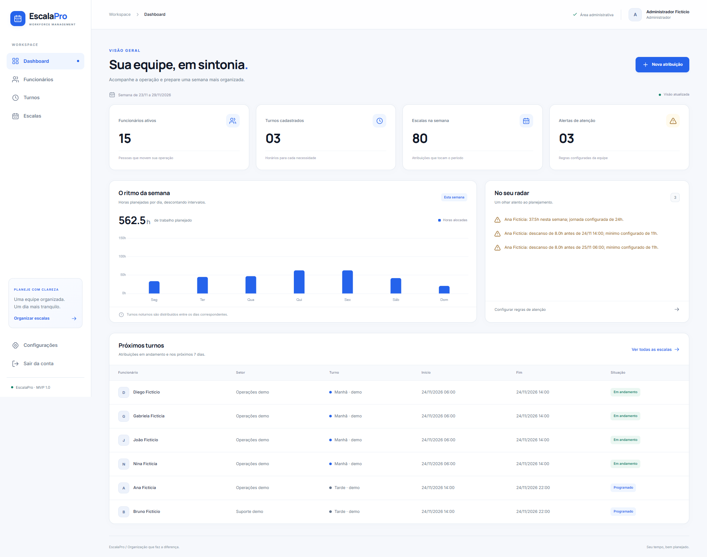
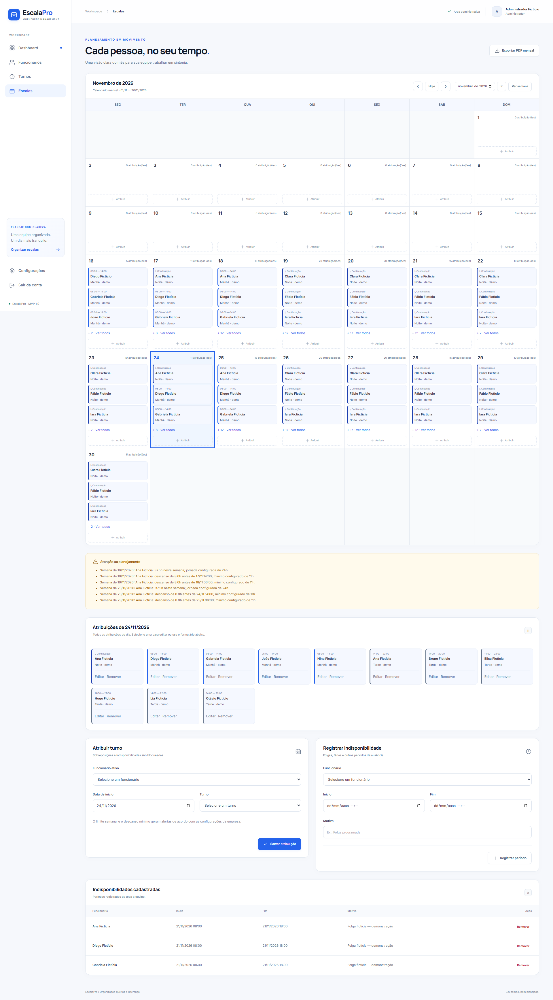
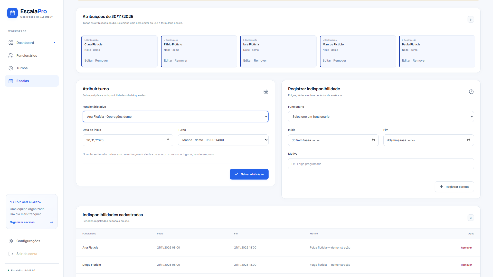
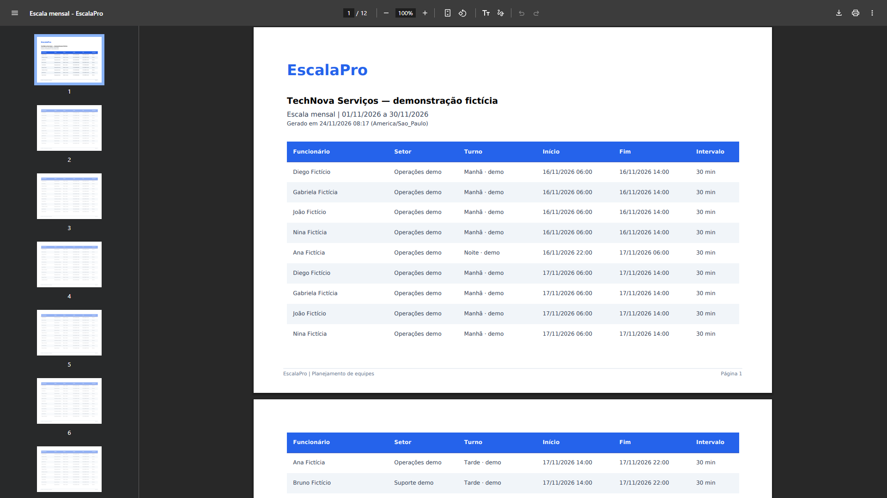

# EscalaPro

**Sistema Inteligente de Gestão de Escalas de Trabalho**

Aplicação web para organizar pessoas, turnos e jornadas com clareza. Projeto de portfólio de Engenharia da Computação, com Flask modular, SQLite/PostgreSQL, interface responsiva e regras de planejamento explícitas.

**Fase 2:** suporte a PostgreSQL, migrações Alembic, Gunicorn, health checks, proxy confiável e outbox criptografada com API HTTPS. SQLite e SMTP continuam disponíveis localmente. O banco principal e o `.env` foram preservados; não houve deploy. A homologação externa ainda está pendente. Consulte [DEPLOYMENT.md](DEPLOYMENT.md) para variáveis, testes Linux, transferência de dados, backup/restauração e custos, e [PRODUCTION_READINESS.md](PRODUCTION_READINESS.md) para o estado de cada achado.

**Estado verificado em 24/11/2026 — A: versão da branch validada para portfólio público, com integração em main pendente.** **278 testes aprovados no Linux/PostgreSQL 18**, sem falhas ou testes ignorados. Windows: 264 aprovados e 14 ignorados, todos executados no Linux. Chromium real: **21 verificações funcionais e 28 combinações de página/resolução**, incluindo desktop, tablet e celular. Foram corrigidos formulários comprimidos e foco do calendário. O [relatório atual](AUDIT_CURRENT.md) registra evidências e limites; produção ainda exige homologação própria.

O [checklist final de portfólio](PORTFOLIO_READINESS_REPORT.md) registra os resultados e as pendências. As **dez capturas reais** estão no [guia de screenshots](docs/screenshots/README.md), com dimensões e instruções de reprodução. Origin foi corrigido com autorização. A [branch portfolio-validation](https://github.com/mduardo1/EscalaPro-/tree/portfolio-validation) foi publicada com autorização e o [CI remoto](https://github.com/mduardo1/EscalaPro-/actions/runs/45399188201) passou com **278 testes aprovados**. A integração em main ainda exige autorização; consulte o [registro de reconciliação](GIT_RECONCILIATION_PLAN.md).

## Interface real com dados fictícios

Dashboard em Chromium, com empresa e pessoas fictícias:



<details>
<summary>Login, calendário, atribuição e PDF</summary>








</details>

| Outras telas | Captura real |
|---|---|
| Funcionários | [Cadastro e equipe](docs/screenshots/03-funcionarios.png) |
| Turnos | [Turnos diurnos e noturno](docs/screenshots/04-turnos.png) |
| Semana | [Calendário semanal](docs/screenshots/07-calendario-semanal.png) |
| Tablet | [768 × 1024](docs/screenshots/09-versao-tablet.png) |
| Celular | [390 × 844](docs/screenshots/10-versao-mobile.png) |

Foram verificadas as resoluções **1920 × 1080, 1366 × 768, 768 × 1024 e 390 × 844**. As imagens de página completa podem ser mais altas que o viewport. A validação usou Chromium desktop com emulação de viewport; outros navegadores e aparelhos físicos continuam pendentes.

## Experimentar com dados fictícios

Recomendado para explorar o portfólio ou desenvolver sem acessar contas reais. Requisitos: Python 3.14 e Git. Na raiz do projeto, use o ambiente virtual existente ou crie um novo em uma instalação limpa:

```powershell
# Apenas se .venv ainda não existir:
py -3.14 -m venv .venv
.\.venv\Scripts\Activate.ps1
python -m pip install -r requirements-dev.txt
python scripts/seed_demo.py --database instance/demo/portfolio.demo.sqlite3
python scripts/run_demo.py --database instance/demo/portfolio.demo.sqlite3
```

Abra **http://127.0.0.1:5001**. O gerador informa o caminho de um arquivo privado `*.demo.credentials.json`, na mesma pasta do banco, com o login e uma senha aleatória exclusiva da demonstração. Abra esse arquivo localmente no editor; não compartilhe seu conteúdo nem capturas do terminal/editor. Não há senha fixa no código.

A demo contém **TechNova Serviços**, administrador fictício, **15 pessoas**, três turnos (incluindo um noturno), **150 atribuições em duas semanas**, folgas e alertas de jornada/descanso. Nomes são explicitamente fictícios e todos os e-mails usam `example.com`. A disponibilidade é implícita nos períodos sem atribuições ou bloqueios; não foi criado outro modelo de disponibilidade.

Os scripts ignoram o `.env` e credenciais herdadas, desativam e-mails e usam exclusivamente `instance/demo/<nome>.demo.sqlite3`. O gerador recusa qualquer arquivo existente, inclusive outra demo; para começar novamente, escolha um nome novo. Não copie o banco real para essa pasta. A demo não executa migrações no banco principal. Para fixar as datas, acrescente `--week AAAA-MM-DD` ao gerador. A chave de sessão é nova a cada execução; reiniciar exige novo login.

Cadastro e recuperação continuam disponíveis na aplicação normal, mas **o envio está desativado na demonstração**. Seus fluxos são testados com remetentes simulados. Para configurações SMTP/API autorizadas, consulte [ACCOUNT_SETUP.md](ACCOUNT_SETUP.md). Não utilize o servidor de demonstração como serviço público.

Veja [GITHUB_READINESS.md](GITHUB_READINESS.md) para auditoria, preservação dos dados e revisão do primeiro commit. Bancos, credenciais, relatórios privados e o `.env` não integram o repositório.

## Funcionalidades

- Login administrativo, logout por POST com revogação no servidor, senhas com hash scrypt do Werkzeug e sessões com limite absoluto de 8 horas.
- Cadastro público de administradores, confirmação por código de e-mail e recuperação de senha com revogação das sessões anteriores.
- Empresas isoladas: cada conta pública acessa somente sua equipe, turnos, escalas, preferências e relatórios. Funcionários cadastrados não recebem login.
- Dashboard com funcionários ativos, turnos, atribuições da semana, alertas, próximos turnos e gráfico de horas.
- Funcionários: cadastro, pesquisa por nome/cargo/setor, edição, desativação e reativação com histórico preservado.
- Turnos: cadastro e edição de nome, início, fim, intervalo e cor.
- Calendário mensal completo como visualização principal, navegação entre meses, botão Hoje e seleção de mês/ano; visualização semanal preservada em **Ver semana**.
- Atribuição diretamente pelo dia, até três resumos por célula e lista completa do dia para consultar, editar e remover turnos.
- Bloqueio de sobreposições e indisponibilidades, inclusive em turnos noturnos.
- Cadastro e remoção de indisponibilidades, como folgas e férias.
- Alertas configuráveis de descanso mínimo e jornada semanal individual.
- Exportação PDF mensal ou semanal com empresa, período, profissionais, turnos, datas, horários e geração.
- Interface em português, com navegação por teclado, foco visível e respeito a movimento reduzido.

## Tecnologias

Python 3.14, Flask 3.1, SQLite (`sqlite3` da biblioteca padrão), Jinja2, Werkzeug, python-dotenv, Flask-WTF, ReportLab, HTML5, CSS3, JavaScript puro, Chart.js, Pytest e pypdf para verificar os relatórios nos testes. `tzdata` fornece fusos IANA no Windows.

Produção preparada com Python 3.14.8, PostgreSQL/psycopg, SQLAlchemy Core, Alembic, Gunicorn no Linux e Fernet para payloads da outbox. `pytest` e `pypdf` passaram para `requirements-dev.txt`; para executar testes, instale esse arquivo.

Sem etapa de build de frontend. Chart.js 4.4.8 é carregado de um CDN com versão fixa; se estiver indisponível, um gráfico simples em HTML exibe os mesmos valores. As fontes gratuitas **Manrope** (títulos) e **Inter** (texto) vêm do Google Fonts, com fontes locais de fallback. As variáveis de tipografia e cores ficam em `app/static/css/variables.css`. Nenhuma fonte proprietária foi incorporada. Os calendários mensal e semanal são renderizados com Jinja2 e CSS; FullCalendar não é necessário para as operações deste MVP.

## Instalação no Windows (PowerShell)

Execute na raiz `EscalaPro`. O ambiente `.venv` existente pode ser reutilizado.

```powershell
# Apenas em uma instalação nova, se .venv não existir:
py -3.14 -m venv .venv

.\.venv\Scripts\Activate.ps1
python -m pip install -r requirements.txt
```

Se o PowerShell impedir a ativação, use diretamente `.\.venv\Scripts\python.exe` no lugar de `python` nos comandos abaixo. Não é preciso alterar a política global de execução.

### Configuração do ambiente

```powershell
# Apenas se ainda não existir .env:
Copy-Item .env.example .env
python -c "import secrets; print(secrets.token_hex(32))"
```

Edite `.env`: coloque o valor gerado em `SECRET_KEY`. Configure SMTP para cadastro público e recuperação, conforme [ACCOUNT_SETUP.md](ACCOUNT_SETUP.md). `ADMIN_NAME`, `ADMIN_EMAIL` e `ADMIN_PASSWORD` são opcionais, usados somente no provisionamento confiável por CLI. Não há senha administrativa padrão; use uma senha exclusiva e não compartilhe esse arquivo. O `.env` real foi preservado nesta implementação.

```dotenv
SECRET_KEY=<chave aleatória gerada localmente>
APP_ENV=development
FLASK_DEBUG=0
APP_TIMEZONE=America/Sao_Paulo
DATABASE_PATH=instance/escalapro.sqlite3
ADMIN_NAME=Administrador
ADMIN_EMAIL=<seu e-mail administrativo>
ADMIN_PASSWORD=<sua senha exclusiva>
```

Os marcadores entre `<...>` são explicativos; substitua-os por valores próprios. Se sua senha contiver `#` ou espaços, coloque o valor entre aspas no `.env`.

### Banco de dados e administrador

```powershell
python -m flask --app run init-db
# Opcional: provisionamento local da empresa original.
python -m flask --app run create-admin
```

`init-db` cria tabelas ausentes e aplica migrações versionadas sem apagar registros. `create-admin` é um comando de provisionamento local da empresa original: lê credenciais do ambiente e se recusa a substituir uma conta existente. Após criá-la, você pode remover `ADMIN_PASSWORD` do `.env`; a autenticação utiliza o hash no banco. Novas contas públicas usam confirmação por e-mail, conforme [ACCOUNT_SETUP.md](ACCOUNT_SETUP.md).

**Instalação existente:** não execute migrações no banco principal para experimentar o portfólio. Utilize a demo acima. Uma atualização real exige autorização, backup e revisão do procedimento em [DEPLOYMENT.md](DEPLOYMENT.md). Não recrie o administrador existente.

### Executar

```powershell
python run.py
```

Abra **http://127.0.0.1:5000** e acesse a plataforma com as credenciais que você configurou. O servidor inicia sem debug e aceita conexões somente da máquina local. `Ctrl+C` encerra o servidor.

Para desenvolver com recarga automática, somente no ambiente local:

```powershell
python -m flask --app run run --debug
```

## Fluxo de uso

1. Em **Configurações**, defina o nome da empresa e as regras de alerta.
2. Em **Funcionários**, cadastre a equipe e sua jornada semanal de referência.
3. Em **Turnos**, cadastre horários e intervalos.
4. Em **Escalas**, registre indisponibilidades e atribua turnos aos funcionários ativos.
5. Navegue entre meses ou selecione mês e ano. Clique em um dia para abrir o formulário com a data preenchida. **Ver todos** mostra as atribuições dos dias com muitos turnos.
6. Use **Exportar PDF mensal** para obter o mês exibido. Para o relatório semanal, abra **Ver semana** e use **Exportar PDF semanal**.

O calendário mensal usa sete colunas, de segunda a domingo, e destaca o dia atual no fuso configurado. Turnos noturnos também aparecem como continuação no dia seguinte, inclusive na virada do mês. Os alertas de jornada permanecem semanais: as semanas que cruzam as bordas do mês são calculadas integralmente. O salvamento recarrega o calendário já atualizado e mantém o período da data salva. Links, formulários e consultas do dia funcionam sem JavaScript. Os limites existentes de janeiro de 2000 a dezembro de 2100 continuam válidos; a melhoria não exige migração.

Uma instalação nova começa sem funcionários ou turnos. O gerador de demonstração e os testes criam dados fictícios apenas em suas bases separadas; nenhum registro do banco principal é reutilizado.

## Regras do planejamento

- A semana vai de segunda-feira, 00h, até a segunda seguinte, 00h, no fuso configurado.
- Se o fim do turno for anterior ao início, ele termina no dia seguinte. Início e fim iguais são rejeitados; turnos de 24 horas não fazem parte deste MVP.
- Intervalos de tempo são semiabertos: um turno pode começar exatamente quando outro termina. O intervalo de refeição não libera o profissional para outro turno durante a atribuição.
- Sobreposições e indisponibilidades **bloqueiam** a gravação. Uma indisponibilidade que conflite com uma escala existente também é rejeitada; ajuste primeiro a atribuição.
- Descanso mínimo e jornada semanal geram **alertas**, sem bloqueio. O descanso inicia desativado (`0h`); a jornada é individual e pode ter o alerta desligado em Configurações. Não existe uma regra legal única embutida no sistema.
- Ao salvar, os alertas incluem a semana seguinte quando um turno noturno atravessa a segunda-feira ou reduz o descanso de uma atribuição já cadastrada. A notificação mostra uma prévia e a contagem restante; os detalhes continuam disponíveis no calendário de cada semana.
- Horas líquidas descontam o intervalo. Como o intervalo tem duração, mas não horário próprio, seu desconto é proporcional quando o turno cruza a borda de um dia/semana.
- Uma atribuição guarda nome, horários, intervalo e cor do turno daquele momento. Editar o cadastro de um turno afeta novas atribuições. Para atualizar uma atribuição existente, edite-a e salve novamente.
- A combinação funcionário/data/turno só pode ser atribuída uma vez, inclusive se os horários do cadastro do turno forem alterados. Nesse caso, edite a atribuição existente; uma tentativa duplicada retorna validação sem alterar o histórico.
- Desativar um funcionário impede novas atribuições e mantém escalas já registradas. Reative-o para voltar a atribuir ou editar seus turnos.
- Os horários são civis locais em um único fuso por instalação. O MVP não calcula transições de horário de verão ou remuneração; cenários com múltiplos fusos exigem evolução do modelo temporal.
- Funcionários e turnos não possuem regra de unicidade de cadastro. Homônimos, e-mails opcionais repetidos e turnos com os mesmos horários são permitidos; seus IDs os distinguem. A pesquisa unificada aceita nome, cargo ou setor; não há seletor exclusivo de setor. A interface não oferece exclusão/desativação de turnos, e chaves estrangeiras impedem remover por SQL um turno referenciado.
- PDFs usam DejaVu Sans incorporada, com licença em `app/assets/fonts/LICENSE.txt`, para preservar acentos e caracteres latinos estendidos. A fonte não cobre toda a escrita Unicode, como CJK e emojis. A tipografia da interface web foi preservada.

## Arquitetura

```text
EscalaPro/
├── app/
│   ├── __init__.py          # Application factory, filtros e tratamento de erros
│   ├── config.py           # Configuração por ambiente
│   ├── database.py         # Conexões e comandos CLI
│   ├── schema.sql          # Tabelas, índices e integridade
│   ├── security.py         # Autorização e tentativas de login
│   ├── models/             # Consultas parametrizadas e persistência
│   ├── routes/             # Blueprints de autenticação, dashboard e cadastros
│   ├── services/           # Validações, planejamento, relógio e PDF
│   ├── templates/          # Layout e componentes Jinja2 reutilizáveis
│   └── static/             # CSS, JavaScript e favicon SVG
├── tests/                  # Banco temporário independente por teste
├── scripts/                # Gerador/servidor demo e auditoria de publicação
├── migrations/             # Revisões Alembic SQLite/PostgreSQL
├── instance/               # SQLite local, ignorado pelo Git
├── .env.example
├── .gitignore
├── pytest.ini
├── requirements.txt
├── README.md
└── run.py                  # Entrada WSGI e servidor local
```

Rotas recebem os dados e apresentam respostas; serviços validam operações; models centralizam o SQL. As conexões são fechadas ao encerrar o contexto Flask, com chaves estrangeiras habilitadas. Atribuições e indisponibilidades usam `BEGIN IMMEDIATE` no SQLite e locks por funcionário no PostgreSQL para validar e gravar atomicamente.

## Testes

Revalidação final de **24/11/2026**, depois das correções de interface, sempre com `-W error`; cobertura de **app, migrations e scripts**:

| Ambiente | Aprovados | Ignorados | Falhas/erros | Linhas | Ramificações | Combinada |
|---|---:|---:|---:|---:|---:|---:|
| Linux/Python 3.14.8/PostgreSQL 18.3 | **278** | **0** | **0** | **92,33%** | **85,40%** | **90,86%** |
| Windows/Python 3.14.3 | 264 | 14 | 0 | 86,28% | 77,19% | 84,35% |

Os 14 ignorados no Windows passaram no Linux. Não somar execuções como testes distintos: a suíte possui 278 casos. A cobertura mede Python e não comprova JavaScript ou responsividade. Evidências e lacunas estão em [AUDIT_CURRENT.md](AUDIT_CURRENT.md); os documentos das etapas anteriores são históricos.

```powershell
python -m pytest -q -W error -o cache_dir=tmp/pytest-cache
```

Os testes cobrem inicialização, autorização, login/logout, hash, CSRF real nos formulários, limite de tentativas, comandos CLI, cadastro/edição/pesquisa/status de funcionários, validações, turnos, conflitos noturnos, indisponibilidades, edição/remoção de escalas, bordas semanais, alertas configuráveis, escape HTML, consultas de pesquisa e conteúdo do PDF. Cada teste utiliza um SQLite isolado em `tmp/pytest/`; o banco principal não é reutilizado. Essa pasta é descartável e recriada pelo Pytest. Não coloque arquivos pessoais nela.

Há testes de contas com códigos e remetentes simulados, isolamento entre empresas, calendário mensal e semanal, anos bissextos, turnos noturnos, PDFs paginados e fluxos HTTP reais em loopback. A revisão adicional em Chromium executou 21 verificações funcionais, incluindo foco, cliques, formulários, confirmações, menu e downloads, além de 28 combinações de página/resolução. O [guia de capturas](docs/screenshots/README.md) explica como executar os testes opcionais Playwright; eles ficam separados da suíte pytest. Consulte [ACCOUNT_SETUP.md](ACCOUNT_SETUP.md) para a configuração das contas.

Para reproduzir a medição, instale `requirements-dev.txt` e execute:

```powershell
python -m pytest -q -W error --cov=app --cov=migrations --cov=scripts --cov-branch --cov-report=term-missing
```

Os testes desativam o carregamento do `.env`, usam credenciais fictícias e não consultam o banco principal. A cobertura mede somente Python, não HTML, CSS ou JavaScript.

Para incluir os 14 casos atuais de integração PostgreSQL/Linux em ambiente descartável, com Docker ativo:

```sh
docker compose --env-file .env.example -f compose.test.yml -p escalapro-tests up --build --abort-on-container-exit --exit-code-from tests
```

Esse comando inicia somente a topologia fictícia de `compose.test.yml`; não aponte testes para a base real. Ao terminar, encerre seus recursos de teste com `docker compose --env-file .env.example -f compose.test.yml -p escalapro-tests down --volumes`. Servidor, `pg_dump` e `pg_restore` 18.3 foram conferidos no Docker. O workflow publicado instalou e selecionou clientes 18.7, executou os 278 testes e validou Gunicorn no [GitHub Actions](https://github.com/mduardo1/EscalaPro-/actions/runs/45399188201). A cobertura remota de app é separada da medição local mais ampla.

Para formatar o código durante o desenvolvimento, instale as ferramentas opcionais de `requirements-dev.txt` e use `python -m black app tests run.py` e `python -m djlint app/templates --reformat`. Elas não são necessárias para executar o sistema.

## Segurança e implantação

- `SECRET_KEY` externa, obrigatória, com ao menos 32 caracteres.
- Hash scrypt, proteção CSRF global, cookies HttpOnly e SameSite=Lax.
- Tokens de autenticação aleatórios com apenas o hash persistido no SQLite. O logout revoga a sessão corrente no servidor; sessões em outros dispositivos continuam independentes. A expiração absoluta também é conferida no servidor.
- Limite persistente de 5 falhas de login por combinação de endereço/e-mail, em janela de 15 minutos. Cabeçalhos de proxy só são aceitos de peers explicitamente confiáveis; a topologia real precisa de homologação.
- Validação no servidor, limites de tamanho de requisição, consultas parametrizadas e escape automático Jinja2.
- Cabeçalhos CSP, anti-frame, `nosniff`, política de referência e `no-store` nas páginas.
- `APP_ENV=production` ativa cookies Secure e HSTS. Use HTTPS, `FLASK_DEBUG=0`, chave exclusiva, backups e um servidor WSGI apropriado. O servidor embutido do Flask é voltado ao desenvolvimento.
- Empresas compartilham o banco com isolamento lógico obrigatório nas consultas e operações, mais restrições de integridade. Cada cadastro público cria sua empresa após confirmar o e-mail. Administradores legados permanecem na empresa original. Trilha de auditoria, convites e perfis de acesso distintos ainda não estão implementados.
- Faça backup consistente do SQLite antes de alterações de schema ou implantação. Não publique `.env`, `instance/`, logs ou bancos de teste.

Referências: [segurança do Flask](https://flask.palletsprojects.com/en/stable/web-security/) e [integração do Chart.js](https://www.chartjs.org/docs/latest/getting-started/integration.html).

## Git e próximos passos

A lista exata dos candidatos fica em [PUBLICATION_MANIFEST.txt](PUBLICATION_MANIFEST.txt). O relatório [GITHUB_READINESS.md](GITHUB_READINESS.md) descreve a auditoria do conteúdo, índice e histórico, incluindo seus limites. O `.gitignore` não remove arquivos já rastreados nem segredos de commits anteriores. Nenhum commit ou push é executado automaticamente.

```powershell
python scripts/audit_publication.py --manifest
git status --short
# Só após revisar e autorizar: seguir os comandos em GITHUB_READINESS.md.
```

Evoluções planejadas: trilha de auditoria, convites e permissões por empresa, monitoramento da fila durável, testes de interface automatizados, paginação/carga, geração assistida de escalas e regras por categoria profissional.

## Licença

Nenhuma licença do projeto foi escolhida. A definição depende de autorização do proprietário. As fontes incorporadas possuem sua própria licença em `app/assets/fonts/LICENSE.txt`, que deve ser preservada.
